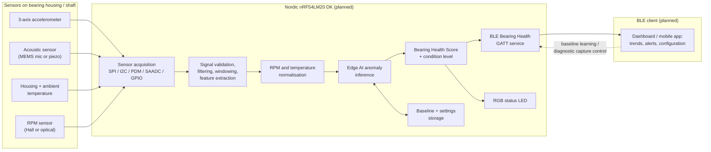

# BearingGuard AI: Early Bearing Fault Detection


> **Project status: Concept and planning stage.**
>
> No hardware has been assembled, no measurements have been recorded, no firmware is functional, and
> no AI model has been trained. Everything in this repository describes a **proposed** architecture and
> a **planned** implementation unless a section explicitly states otherwise. Placeholder files are
> marked `Status: Placeholder` or `Status: Planned` and contain `TODO` items.

## Table of contents

1. [Project summary](#project-summary)
2. [Problem statement](#problem-statement)
3. [Proposed solution](#proposed-solution)
4. [Main sensing channels](#main-sensing-channels)
5. [Role of the Nordic nRF54LM20 DK](#role-of-the-nordic-nrf54lm20-dk)
6. [Planned Edge AI pipeline](#planned-edge-ai-pipeline)
7. [Planned Bluetooth Low Energy functionality](#planned-bluetooth-low-energy-functionality)
8. [Condition levels](#condition-levels)
9. [High-level block diagram](#high-level-block-diagram)
10. [Preliminary system architecture](#preliminary-system-architecture)
11. [Preliminary bill of materials](#preliminary-bill-of-materials)
12. [Planned test rig](#planned-test-rig)
13. [Planned controlled test conditions](#planned-controlled-test-conditions)
14. [Data collection plan](#data-collection-plan)
15. [Main implementation milestones](#main-implementation-milestones)
16. [Sustainability impact](#sustainability-impact)
17. [Safety statement](#safety-statement)
18. [Project limitations](#project-limitations)
19. [Repository structure](#repository-structure)
20. [Contributing](#contributing)
21. [License](#license)
22. [Disclaimer](#disclaimer)

## Project summary

BearingGuard AI is a Bluetooth-enabled predictive-maintenance demonstrator based on the Nordic
nRF54LM20 DK. It will combine three-axis vibration, acoustic, bearing-housing temperature, and
rotational-speed measurements to detect early deviations from the learned healthy operating condition
of a metal rolling-element bearing. The planned system will use Edge AI running directly on the
development kit for local anomaly detection, and Bluetooth Low Energy (BLE) for configuration,
machine-health reporting, trend monitoring, and maintenance alerts. The project is designed around a
small, guarded laboratory test rig on which controlled fault conditions can be reproduced safely.

## Problem statement

Rolling-element bearings are among the most common failure points in rotating machinery such as
motors, pumps, fans, conveyors, and spindles. Bearing degradation usually develops gradually: lubricant
breakdown, surface fatigue, contamination, misalignment, or imbalance produce subtle changes in
vibration, sound, and temperature long before the bearing fails outright. In practice these early
signs are frequently missed because:

- Many small and medium-sized machines are not instrumented at all.
- Periodic manual inspection catches problems only if they happen to be present during the visit.
- Traditional condition-monitoring systems are wired, expensive, and need specialist interpretation.
- Simple threshold alarms generate false alarms when speed or load changes, so they are often ignored.

Unplanned bearing failure leads to unscheduled downtime, collateral damage to shafts and housings,
scrap production, premature replacement of otherwise healthy equipment, and avoidable safety risks.

## Proposed solution

BearingGuard AI proposes a compact, wireless, self-learning monitoring node that:

1. Measures vibration, acoustic emission, housing temperature, and shaft speed at the bearing.
2. Learns the signature of the **healthy** operating condition during a supervised baseline phase.
3. Runs a lightweight anomaly-detection model locally on the nRF54LM20 DK, so that raw signals never
   need to leave the device.
4. Normalises features against RPM and ambient temperature to reduce false alarms caused by normal
   operating-point changes.
5. Converts the anomaly score into an easy-to-read **Bearing Health Score** and a four-level
   condition indicator (green, yellow, orange, red).
6. Reports health, trends, and maintenance recommendations over BLE to a phone, tablet, or gateway,
   and shows the condition locally on an RGB LED.

The first realistic objective is reliable **anomaly detection relative to a healthy baseline** on a
controlled test rig. Exact fault classification and remaining-useful-life prediction are explicitly
out of scope for the first iteration (see [Project limitations](#project-limitations)).

## Main sensing channels

| Channel | Planned sensor | Mounting | What it is expected to reveal |
|---|---|---|---|
| Three-axis vibration | Digital MEMS accelerometer (SPI or I2C) | Rigidly on the bearing housing, axes aligned to radial/axial directions | Imbalance, misalignment, looseness, rolling-element and race defects, impulsive events |
| Acoustic signal | MEMS microphone (PDM) **or** piezoelectric contact sensor (analog, via ADC) | Close to or in contact with the bearing housing | Higher-frequency friction, lubrication deficiency, early surface damage, audible rattling |
| Bearing-housing temperature | Digital temperature sensor or NTC thermistor, plus an ambient reference sensor | On the housing surface, with an ambient reference away from heat sources | Friction heating, lubrication failure, overload, temperature-rise rate |
| Rotational speed | Hall-effect sensor with magnet, or optical sensor with reflective marker | On the shaft or coupling | Operating point for normalisation, speed-dependent spectral features, order analysis |

Exact sensor selection is **planned** and will be documented in
[`hardware/bom/preliminary_bom.csv`](hardware/bom/preliminary_bom.csv) and the driver placeholders under
[`firmware/drivers/`](firmware/drivers/).

## Role of the Nordic nRF54LM20 DK

The nRF54LM20 DK is the planned central processing and communication platform. Based on publicly
available product information (to be verified against the official product specification before
design freeze), the nRF54LM20A SoC offers features that map well onto this application:

| Need | Planned use of the nRF54LM20 DK |
|---|---|
| Sensor acquisition | SPI/I2C for the accelerometer and digital temperature sensor, PDM for a MEMS microphone, the SAADC for analog sensors (piezo or NTC), and GPIO/timer capture for the RPM pulse train |
| Signal processing and feature extraction | 128 MHz Arm Cortex-M33 with FPU and DSP instructions for filtering, windowing, and FFT-based features |
| Edge AI inference | On-device inference with a small anomaly-detection model (for example TensorFlow Lite for Microcontrollers or an Edge Impulse export) within the available RAM and non-volatile memory |
| Wireless reporting | Bluetooth LE for the planned custom Bearing Health GATT service, notifications, and configuration |
| Baseline and configuration storage | On-chip non-volatile memory (settings subsystem / NVS) for learned baseline statistics and thresholds |
| Local indication | RGB status LED driven by PWM or GPIO |
| Development and debugging | On-board debugger, virtual UART logging, and current-measurement pins for power profiling |

The firmware is planned to be built with the **nRF Connect SDK** (Zephyr RTOS). The expected board
target is `nrf54lm20dk/nrf54lm20a/cpuapp`; this must be confirmed against the SDK release used
(see [`firmware/README.md`](firmware/README.md)).

> The nRF54LM20 DK hardware has **not** yet been acquired by the project. All statements about its use
> are planning statements.

## Planned Edge AI pipeline

```text
Sensor acquisition
  -> signal validation (range, saturation, dropout, sensor presence)
  -> filtering (anti-alias, DC removal, band limiting)
  -> windowing (fixed-length frames with overlap)
  -> time-domain feature extraction (RMS, peak-to-peak, crest factor, kurtosis, impulse count)
  -> frequency-domain feature extraction (spectral-band energies, dominant peaks)
  -> RPM and temperature normalisation
  -> multisensor feature fusion (vibration + acoustic + thermal + speed)
  -> Edge AI anomaly inference (deviation from learned healthy baseline)
  -> Bearing Health Score (0-100) and condition level
  -> maintenance recommendation
  -> BLE notification and local LED indication
```

The model will first be trained **offline** on recordings from the test rig and then deployed to the
device. The planned candidates are a statistical baseline model (feature-space distance), followed by
a small autoencoder or one-class classifier if the baseline proves insufficient. Details are in
[`docs/edge_ai_plan.md`](docs/edge_ai_plan.md) and the model card placeholder
[`models/model_cards/bearing_anomaly_model.md`](models/model_cards/bearing_anomaly_model.md).

## Planned Bluetooth Low Energy functionality

A custom **Bearing Health Service** is planned, exposing (preliminary, UUIDs not yet allocated):

- Bearing Health Score, Condition Level, Anomaly Score, Maintenance Recommendation
- Vibration RMS, Vibration Crest Factor, Acoustic Energy, Housing Temperature, RPM
- Device Status, Baseline Learning Control, Diagnostic Capture Control

Planned interaction patterns: periodic notifications of health and trend data, on-demand reads of
raw feature values, writes to start or reset baseline learning, and a diagnostic capture mode that
streams a short feature history for engineering analysis. Pairing with LE Secure Connections is
planned for all write operations. See [`docs/bluetooth_service_plan.md`](docs/bluetooth_service_plan.md).

## Condition levels

| Level | LED colour | Meaning | Planned recommendation |
|---|---|---|---|
| **Green** | Green | Behaviour consistent with the learned healthy baseline | No action; continue monitoring |
| **Yellow** | Yellow | Small but sustained deviation from baseline | Observe trend; verify mounting, lubrication, and operating point at next routine check |
| **Orange** | Orange | Significant deviation, persistent over several evaluation windows | Plan an inspection or bearing replacement at the next scheduled stop |
| **Red** | Red | Severe deviation and/or rapid deterioration trend | Recommend stopping the machine for inspection as soon as safely possible |

The condition level is **advisory only**. The device will not control the machine, and the numeric
thresholds that map the anomaly score to these levels are `TODO` and will be calibrated only after
healthy-baseline and fault-condition data have been collected.

## High-level block diagram



## Preliminary system architecture

The proposed architecture is split into five layers. Each layer corresponds to a directory in this
repository and is described in more depth in [`docs/architecture.md`](docs/architecture.md).

1. **Mechanical test rig** (`mechanical/`): guarded motor-shaft-bearing assembly with interchangeable
   bearings, adjustable load, and an imbalance disk, so that healthy and degraded conditions can be
   produced on demand.
2. **Sensing and interface hardware** (`hardware/`): sensor breakout boards or a small sensor carrier
   board, wiring to the DK, RPM sensor, status LED, power supply, and emergency stop.
3. **Embedded firmware** (`firmware/`): Zephyr/nRF Connect SDK application with sensor drivers, DSP and
   feature extraction, Edge AI inference, health scoring, BLE service, storage, and self-diagnostics.
4. **Data and model pipeline** (`datasets/`, `tools/`, `models/`): capture tooling, signal analysis,
   feature extraction, model training, evaluation, and export to an embedded format.
5. **User interface** (`tools/ble_dashboard/`): a BLE dashboard for configuration, live health display,
   trend monitoring, and alert history.

## Preliminary bill of materials

The full preliminary BOM is maintained in [`hardware/bom/preliminary_bom.csv`](hardware/bom/preliminary_bom.csv).
All items are currently **Planned**; no exact part numbers have been selected or purchased.

| Category | Item (planned) |
|---|---|
| Processing / connectivity | Nordic nRF54LM20 DK |
| Sensing | Three-axis digital accelerometer; MEMS microphone or piezoelectric contact sensor; digital temperature sensor or NTC thermistor (housing and ambient); Hall-effect or optical RPM sensor with small magnet or optical marker |
| Drive train | Low-voltage DC or BLDC motor; motor driver or speed controller; shaft; flexible shaft coupling; bearing supports; replaceable metal ball bearings |
| Fault injection | Adjustable mechanical load or brake; imbalance disk and test masses |
| Indication and safety | RGB status LED; emergency stop switch; transparent protective guard |
| Infrastructure | Low-voltage power supply; base plate; sensor mounting brackets; cables and connectors |

## Planned test rig

A small bench-top rig is planned, consisting of a low-voltage motor driving a short shaft through a
flexible coupling, two bearing supports with replaceable metal ball bearings, an imbalance disk, an
adjustable load or brake, and an RPM sensor. Sensors will be mounted on the test-bearing housing. The
rig will be built on a rigid base plate, fitted with an emergency stop switch, enclosed by a
transparent protective guard, and operated at a controlled, limited maximum speed. See
[`docs/test_rig_plan.md`](docs/test_rig_plan.md).

## Planned controlled test conditions

| Condition | How it is planned to be produced | Purpose |
|---|---|---|
| Healthy baseline | New, correctly mounted, lubricated bearing; balanced disk; aligned shaft; nominal load | Train the baseline model; reference for all deviations |
| Mechanical imbalance | Add calibrated test masses to the imbalance disk in steps | Speed-synchronous vibration increase |
| Controlled misalignment | Insert shims under one bearing support or offset the coupling by a measured amount | Axial/radial vibration pattern changes |
| Loose bearing-housing mounting | Loosen housing fasteners to a defined, limited torque | Looseness, impulsiveness, increased kurtosis |
| Increased mechanical load | Apply the adjustable load or brake in steps | Temperature rise, load-dependent vibration |
| Pre-worn bearing | Install bearings that were run-in, contaminated, or deliberately degraded by a documented procedure | Realistic early-degradation signatures |

Each condition will be recorded at several speeds and repeated in multiple independent runs. Severity
levels will be documented in the recording metadata.

## Data collection plan

- Recordings will be captured in complete **measurement runs** with a unique run identifier.
- Metadata will include the bearing identifier, RPM, load level, sensor positions, ambient and housing
  temperature, test condition, severity, and operator notes
  ([`datasets/metadata/recording_metadata_template.csv`](datasets/metadata/recording_metadata_template.csv)).
- Training, validation, and test sets will be split by **complete run**, never by random sample, so that
  correlated windows from the same run do not leak across partitions.
- Large raw data will **not** be committed to this repository; it will be stored externally and
  referenced by metadata.
- Raw audio will not be permanently retained unless required and legally appropriate.
- Any synthetic or augmented data will be clearly labelled.

Full plan: [`docs/data_collection_plan.md`](docs/data_collection_plan.md).

## Main implementation milestones

| # | Milestone | Status |
|---|---|---|
| M0 | Repository scaffold, architecture, and planning documents | In progress (this scaffold) |
| M1 | Hardware acquisition: nRF54LM20 DK, sensors, motor, rig components | Planned |
| M2 | Mechanical test rig assembled with guard and emergency stop; safety review | Planned |
| M3 | Firmware bring-up: sensor drivers, RPM capture, logging over UART/USB | Planned |
| M4 | Data capture tooling and first healthy-baseline recording campaign | Planned |
| M5 | Offline signal analysis and feature design | Planned |
| M6 | Controlled fault campaigns (imbalance, misalignment, looseness, load, pre-worn bearing) | Planned |
| M7 | Model training, evaluation, and model card | Planned |
| M8 | On-device feature extraction and inference; health score and LED indication | Planned |
| M9 | BLE Bearing Health Service and dashboard | Planned |
| M10 | End-to-end validation, documentation, Hackster publication | Planned |

Details and dependencies: [`docs/project_plan.md`](docs/project_plan.md).

## Sustainability impact

Predictive maintenance is expected to contribute to sustainability by replacing bearings when they
actually begin to degrade instead of on a fixed schedule, by preventing secondary damage to shafts,
housings, and motors, by reducing scrap and rework caused by unplanned stoppages, and by keeping
drive trains operating efficiently (worn bearings increase friction and energy consumption). The
demonstrator itself is designed to be low-power, wireless (no cabling infrastructure), and based on a
reusable test rig. These are **expected** benefits; the project has not yet quantified any of them.
See [`docs/sustainability.md`](docs/sustainability.md).

## Safety statement

The planned test rig contains rotating parts, stored rotational energy, and an electric motor.

- Rotating parts must **never** be operated without a suitable physical guard in place.
- An emergency stop switch that removes motor power must be fitted and tested before every session.
- The maximum speed must be limited in hardware or firmware to a documented, conservative value.
- Imbalance masses and loose-mounting tests must be strictly bounded and risk-assessed beforehand.
- Hearing protection and eye protection are required when the rig is running.

BearingGuard AI is an **advisory monitoring demonstrator**. It is not a safety device, does not control
the machine, and must never be used as a substitute for machine guarding, interlocks, or certified
protective systems. Full statement: [`docs/safety.md`](docs/safety.md).

## Project limitations

- The project is at the concept stage; no results exist yet.
- The first iteration targets anomaly detection relative to a healthy baseline, not fault
  classification or remaining-useful-life prediction.
- Models trained on one bearing type, one rig, and laboratory conditions are not expected to transfer
  to other machines without new baseline learning.
- Fault conditions on the rig are induced artificially and may not fully represent field degradation.
- Sensor placement, mounting stiffness, and rig resonances strongly influence vibration features.
- Resource constraints of an embedded target limit model size and sampling rates.

Full list: [`docs/limitations.md`](docs/limitations.md).

## Repository structure

```text
bearingguard-ai/
├── firmware/      Planned nRF Connect SDK / Zephyr application (app, boards, drivers, bluetooth, dsp, edge_ai, tests)
├── hardware/      Block diagrams, schematics, PCB, wiring, preliminary BOM, datasheet references
├── mechanical/    Test-rig CAD, drawings, sensor mounts, safety guard
├── models/        Model training notes, exported models, evaluation, model cards
├── tools/         Host-side tooling: data capture, signal analysis, feature extraction, training, BLE dashboard
├── datasets/      Dataset policy, raw/processed placeholders, metadata template, examples
├── docs/          Architecture, project plan, test rig, data collection, BLE service, Edge AI, safety, sustainability, limitations
├── media/         Cover image, diagrams, photos, video references
├── hackster/      Hackster.io project story, hardware application, project logs, attachment descriptions
└── .github/       Issue templates and pull request template
```

Every directory contains a `README.md` explaining its purpose, expected files, planned implementation,
current status, and open `TODO` items.

## Contributing

Contributions, reviews, and suggestions are welcome, especially on sensor selection, test-rig safety,
feature design, and BLE service design. Please read [`CONTRIBUTING.md`](CONTRIBUTING.md) and the
[`CODE_OF_CONDUCT.md`](CODE_OF_CONDUCT.md), and use the issue templates in
[`.github/ISSUE_TEMPLATE/`](.github/ISSUE_TEMPLATE/).

## License

This project is licensed under the Apache License, Version 2.0. See [`LICENSE`](LICENSE).
Future source files will carry an `SPDX-License-Identifier: Apache-2.0` header as described in
[`CONTRIBUTING.md`](CONTRIBUTING.md). Documentation is provided under the same license unless stated
otherwise.

## Disclaimer

BearingGuard AI is an **experimental predictive-maintenance demonstrator** developed for research,
education, and evaluation purposes. It is **not** certified industrial protection equipment, **not**
an emergency shutdown system, and **not** a substitute for machine guarding, safety interlocks,
certified condition-monitoring systems, or professional engineering judgement. Any health score,
condition level, or maintenance recommendation produced by the planned system is advisory only and
must be verified by qualified personnel before action is taken. The authors accept no liability for
damage, injury, or loss resulting from the use of the information or designs in this repository.
