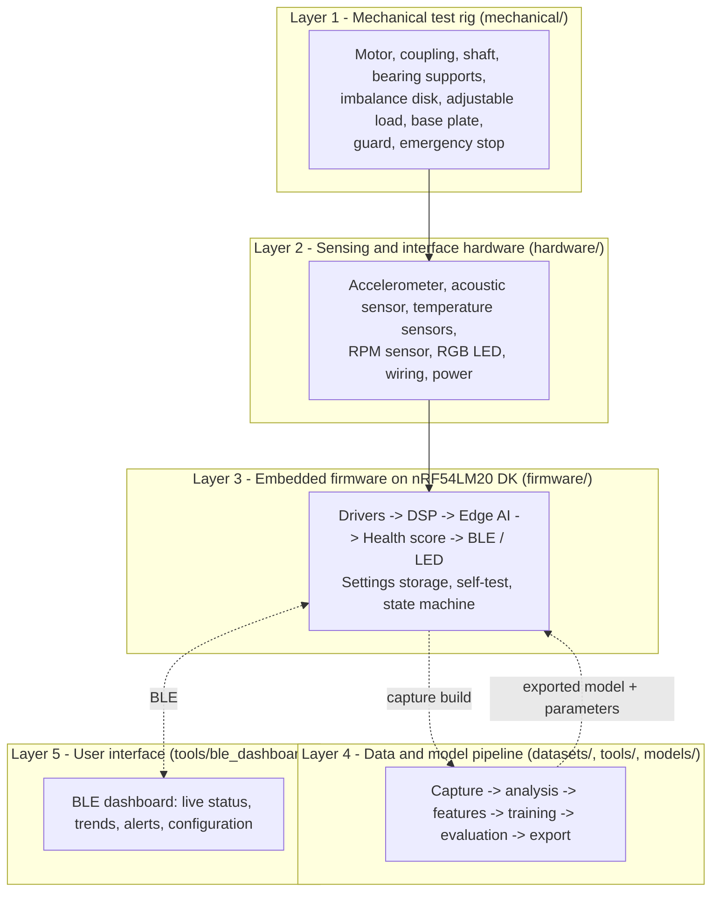
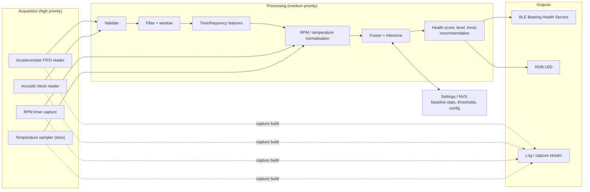

# System Architecture

**Status: Draft - preliminary architecture.** Nothing described here has been implemented. This document
defines the proposed structure of BearingGuard AI so that hardware, firmware, data, and model work can
proceed consistently. It will be revised as decisions are made.

## 1. Architectural goals

| Goal | Consequence for the architecture |
|---|---|
| Detect early deviation from a healthy baseline on one bearing | Multisensor features, baseline learning, anomaly scoring rather than fixed thresholds |
| Work without infrastructure | Battery- or USB-powered node, BLE to a phone/PC, no wiring to a controller |
| Keep raw data on the device | On-device feature extraction and inference; only features and scores leave via BLE |
| Be honest about uncertainty | Health score plus condition level with hysteresis; "outside learned range" state; advisory only |
| Be reproducible | Identical feature definitions offline and on-device; run-level dataset splits; model cards |
| Be safe to develop and demonstrate | Rig guarded and e-stopped independently of the device; the device never controls the motor |

## 2. Layered view

## 3. Components and responsibilities

### 3.1 Mechanical test rig

Produces controlled healthy and degraded conditions. See [`test_rig_plan.md`](test_rig_plan.md).
Architecturally relevant properties: rigid base (resonances outside the measurement band where
possible), instrumented bearing support with defined sensor surfaces, repeatable fault injection,
independent emergency stop and guard.

### 3.2 Sensing hardware

| Sensor | Interface to DK | Data rate class | Notes |
|---|---|---|---|
| 3-axis accelerometer | SPI (preferred) with FIFO and interrupt | kHz-class per axis | Primary channel |
| Acoustic: MEMS microphone **or** piezo contact sensor | PDM **or** SAADC via analog front end | kHz-class | Decision pending |
| Housing and ambient temperature | I2C digital **or** SAADC with NTC dividers | ~1 Hz | Two sensors of the same type |
| RPM | GPIO pulse to timer capture | pulses per revolution | Hall or optical |
| RGB LED | PWM x3 | - | Condition indication |

Electrical separation: motor power path (supply -> e-stop -> driver -> motor) is independent from the
sensing path (DK, sensors). Optional isolated e-stop *status* input to the DK is monitoring only.

### 3.3 Firmware

Zephyr / nRF Connect SDK application; see [`../firmware/README.md`](../firmware/README.md).

Application state machine (preliminary):

| State | Entry | Behaviour | Exit |
|---|---|---|---|
| `INIT` | Power-on | Init peripherals, load settings | -> `SELF_TEST` |
| `SELF_TEST` | From `INIT` | Sensor presence, sample-rate check, RPM signal check | pass -> `MONITORING` or `BASELINE_LEARNING` (if no baseline); fail -> `FAULT` |
| `BASELINE_LEARNING` | BLE command (authenticated) or no stored baseline | Accumulate healthy statistics per RPM bin; report coverage | complete -> `MONITORING`; abort -> previous state |
| `MONITORING` | Baseline available | Periodic evaluation; notifications; LED | BLE command -> `DIAGNOSTIC_CAPTURE`; error -> `FAULT` |
| `DIAGNOSTIC_CAPTURE` | BLE command | Stream bounded feature history; monitoring continues | timeout or command -> `MONITORING` |
| `FAULT` | Any unrecoverable error | LED fault pattern, Device Status reports cause | reset or BLE command after fix -> `INIT` |

### 3.4 Data and model pipeline

Capture build of the firmware streams raw samples to `tools/data_capture`; recordings are stored
externally with metadata; `tools/feature_extraction` computes the same features as the firmware;
`tools/model_training` fits the statistical baseline and optional neural model, evaluates with run-level
splits, and exports parameters and model data to `models/exported` for inclusion in the firmware.
See [`data_collection_plan.md`](data_collection_plan.md) and [`edge_ai_plan.md`](edge_ai_plan.md).

### 3.5 User interface

A BLE client (desktop or mobile; decision pending) for live status, trends, alerts, and configuration.
See [`bluetooth_service_plan.md`](bluetooth_service_plan.md) and
[`../tools/ble_dashboard/README.md`](../tools/ble_dashboard/README.md).

## 4. Key interfaces

| Interface | Between | Definition owner | Status |
|---|---|---|---|
| Sensor wiring and pin assignment | hardware <-> firmware/boards | `hardware/wiring/` + devicetree overlay | TODO |
| Feature vector specification | firmware/dsp <-> tools/feature_extraction <-> models | `dsp_feature_vector.h` + spec file | TODO |
| Model parameter file | models/exported <-> firmware/edge_ai | JSON schema | TODO |
| Bearing Health Service | firmware/bluetooth <-> tools/ble_dashboard | `bluetooth_service_plan.md` | Draft, UUIDs TODO |
| Capture stream protocol | firmware capture build <-> tools/data_capture | `tools/data_capture/protocol.py` + firmware | TODO |
| Metadata schema | tools/data_capture <-> datasets <-> models | `datasets/metadata/README.md` | Draft |

## 5. Condition levels and LED indication (planned)

| Condition / state | LED pattern (preliminary) |
|---|---|
| Green | Steady green |
| Yellow | Steady yellow |
| Orange | Steady orange |
| Red | Blinking red |
| Baseline learning | Slow-pulsing blue |
| Outside learned RPM range / machine stopped | Dim white |
| Fault | Fast-blinking red/white alternating |
| BLE connected | Short double-blink overlay on connection events |

Patterns are placeholders and will be finalised with usability feedback.

## 6. Non-functional requirements (preliminary)

| Aspect | Requirement |
|---|---|
| Reaction time | A sustained deviation should be reflected in the condition level within a few evaluation periods (value TODO) |
| False alarms | Target false-alarm budget on healthy held-out runs to be defined in `models/evaluation/` |
| Robustness | Loss of one sensor degrades gracefully to a reduced feature set with a Device Status flag |
| Persistence | Baseline and configuration survive power cycles |
| Security | Authenticated, encrypted link required for all BLE writes |
| Observability | Device Status characteristic plus logging for every state change and fault |

## 7. Open architectural decisions

| Decision | Options | Target milestone |
|---|---|---|
| Acoustic sensor type | PDM MEMS microphone vs. piezo contact sensor | M5 (signal analysis) |
| Temperature sensing | Digital I2C sensors vs. NTC thermistors | M1 |
| Inference runtime | TensorFlow Lite Micro vs. Edge Impulse vs. statistical only | M7 |
| Capture transport | USB-CDC vs. RTT vs. BLE | M3 |
| Dashboard platform | Desktop Python vs. web/mobile | M9 |
| Custom carrier board | Breakouts only vs. small carrier PCB | After M3 |

## TODO

- [ ] Resolve open decisions and update this document with the outcomes.
- [ ] Add a timing budget once sample rates and window lengths are fixed.
- [ ] Add a memory budget once the inference runtime is chosen.
