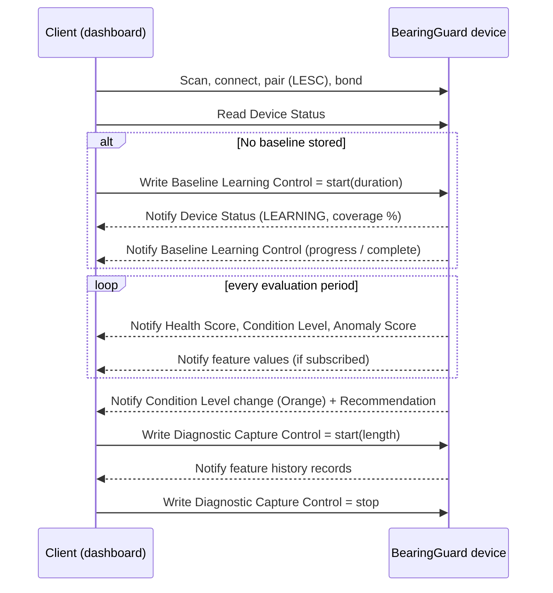

# Bluetooth Service Plan

**Status: Draft - preliminary, non-final BLE architecture.** Nothing has been implemented. UUIDs have
**not** been allocated; all formats and behaviours below are proposals for review.

## 1. Role of Bluetooth Low Energy in BearingGuard AI

BLE is the reporting and configuration channel between the device (GAP peripheral, GATT server) and a
client (phone, tablet, or PC dashboard). It is used for:

- machine-health reporting (health score, condition level, anomaly score, recommendation),
- trend monitoring (periodic feature values),
- maintenance alerts (notifications on level changes),
- configuration (baseline learning, diagnostic capture, device settings).

BLE is **never** used to control the test-rig motor or any machine function.

## 2. GAP and connection parameters (preliminary)

| Item | Plan |
|---|---|
| Role | Peripheral; one central connection at a time (more only if needed) |
| Device name | `BearingGuard-XXXX` (last two bytes of the address) - TODO confirm |
| Advertising | Connectable; includes the Bearing Health Service UUID and, optionally, the current condition level in manufacturer-specific data so that a scanner can show the level without connecting |
| Advertising interval | Slow when healthy, faster for a short period after a level change (values TODO) |
| Connection interval | Chosen for low power with a notification rate equal to the evaluation period (values TODO) |
| PHY | 1M by default; 2M if the client supports it (optional) |

## 3. Security (preliminary)

- Pairing with **LE Secure Connections**; bonding so that a known client reconnects without re-pairing.
- Read and notify of health data: allowed on an encrypted link (optionally unencrypted for the
  "demo-friendly" profile - decision TODO).
- **All writes** (control characteristics) require an encrypted **and authenticated** link; MITM
  protection requires a pairing method with user interaction (passkey) - method TODO given the DK's
  I/O capabilities.
- Unauthenticated writes are rejected with an ATT error.

## 4. Services

| Service | Type | Purpose |
|---|---|---|
| Bearing Health Service (BHS) | Custom, 128-bit UUID (**TODO allocate**) | All BearingGuard AI data and controls |
| Device Information Service | Standard (0x180A) | Manufacturer name, model number, firmware and hardware revision |
| Battery Service | Standard (0x180F), optional | Only if a battery-powered variant is built |

## 5. Bearing Health Service characteristics (preliminary)

Byte order little-endian. Units and scaling are proposals. Each characteristic will receive a
Characteristic Presentation Format descriptor where applicable.

| # | Characteristic | Properties | Format (proposal) | Description |
|---|---|---|---|---|
| 1 | Bearing Health Score | Read, Notify | `uint8` 0-100 | Overall health; 100 = fully consistent with baseline |
| 2 | Condition Level | Read, Notify | `uint8` enum: 0 Green, 1 Yellow, 2 Orange, 3 Red, 4 Learning, 5 Outside learned range / stopped, 6 Fault | Current level incl. non-monitoring states |
| 3 | Vibration RMS | Read, Notify | `uint16` in milli-g (or m/s^2 x 100) per axis x3 + combined (`uint16[4]`) | Overall vibration level |
| 4 | Vibration Crest Factor | Read, Notify | `uint16` x 100 (combined or per axis - TODO) | Peak / RMS |
| 5 | Acoustic Energy | Read, Notify | `uint16` in dB-like units x 10 or normalised energy (TODO) | Acoustic RMS / band energy summary |
| 6 | Housing Temperature | Read, Notify | `int16` in 0.01 degC; plus ambient `int16` (`int16[2]`) | Housing and ambient temperature |
| 7 | RPM | Read, Notify | `uint16` revolutions per minute | Measured shaft speed |
| 8 | Anomaly Score | Read, Notify | `uint16` x 100 (smoothed) + `uint8` dominant feature group | Model output and explainability hint |
| 9 | Maintenance Recommendation | Read, Notify | `uint8` enum (0 none, 1 observe trend, 2 plan inspection, 3 stop for inspection, 4 check sensor/installation) + optional UTF-8 string | Advisory recommendation |
| 10 | Device Status | Read, Notify | Bit field `uint32`: state (INIT/SELF_TEST/LEARNING/MONITORING/CAPTURE/FAULT), sensor OK flags, baseline present, baseline coverage %, error code | Device state for the client |
| 11 | Baseline Learning Control | Write (authenticated), Read, Notify | Command `uint8`: 0 stop, 1 start, 2 reset, 3 commit; parameters: duration `uint16` s; status/progress reported via Notify | Starts, stops, resets baseline learning |
| 12 | Diagnostic Capture Control | Write (authenticated), Read, Notify | Command `uint8`: 0 stop, 1 start feature-history stream; parameters: length `uint16` evaluations, channel mask | Starts a bounded feature-history stream (no raw audio) |

Additional characteristics under consideration: Feature History Data (Notify-only stream used by #12),
Configuration (evaluation period, notification mask), Time Sync (client time for timestamping trends).

## 6. Notification behaviour (preliminary)

- Health Score, Condition Level, Anomaly Score, and Recommendation are notified once per evaluation
  period if subscribed, and **immediately** on a level change.
- Feature characteristics (3-7) are notified once per evaluation period if subscribed; the client may
  subscribe selectively to save power.
- Device Status is notified on every state change.
- Diagnostic capture uses a dedicated Notify-only characteristic with sequence numbers; the client
  requests a bounded number of records and acknowledges by writing to #12.

## 7. Client flows

## 8. Mapping to firmware and tooling

- Implementation: [`../firmware/bluetooth/README.md`](../firmware/bluetooth/README.md).
- Client: [`../tools/ble_dashboard/README.md`](../tools/ble_dashboard/README.md).
- Encoding tests on both sides must use the same test vectors.

## 9. Open items

| Item | Status |
|---|---|
| **UUID allocation for the service and all characteristics** | **TODO** - generate a base 128-bit UUID and derive characteristic UUIDs; record them here and in `bhs_uuids.h` |
| Exact units and scaling of feature characteristics | TODO after feature design |
| Pairing method and whether reads are allowed without encryption | TODO |
| Whether the condition level is advertised | TODO (privacy vs. convenience) |
| Multi-connection support | TODO |
| Over-the-air firmware/model update | Out of scope for the first version |

## TODO

- [ ] Allocate UUIDs.
- [ ] Finalise formats and presentation descriptors after the feature specification is frozen.
- [ ] Define the security profile and verify it with a reference client.
- [ ] Review against Bluetooth SIG naming rules for custom services before publication.
