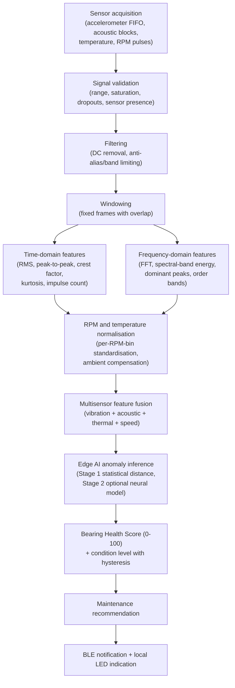

# Edge AI Plan

**Status: Draft.** No signal processing or model code exists and no model has been trained. This document
defines the planned on-device processing flow and the modelling strategy.

## 1. Objective

The first realistic objective is **anomaly detection relative to a learned healthy baseline** of a
single bearing on the test rig: the system should notice that the bearing is behaving differently from
when it was known to be healthy, and express how different in a stable, interpretable way.

It is **not** an objective of the first iteration to classify the fault type or to predict the exact
remaining useful life. Those require far more data, more bearing specimens, and run-to-failure
experiments that are outside the current scope.

## 2. Planned processing flow

### Stage descriptions

| Stage | Planned behaviour |
|---|---|
| Sensor acquisition | Continuous, timestamped blocks from each sensor; RPM attached to each block |
| Signal validation | Reject or flag blocks with saturation, gaps, stuck values, or missing sensors; degrade gracefully to the available channels and flag in Device Status |
| Filtering | Remove DC/offset; band-limit to the range covered by the sensor mount; optional integration to velocity for low-frequency features |
| Windowing | Fixed-length frames (length TODO) with overlap (TODO); Hann window before FFT |
| Time-domain features | Per axis and combined; see feature list below |
| Frequency-domain features | FFT via CMSIS-DSP; band energies with fixed edges and optionally **order-normalised** edges using RPM |
| Normalisation | Standardise each feature with baseline mean/scale **per RPM bin** (or regression on RPM); subtract ambient temperature for thermal features |
| Fusion | Concatenate normalised features into one vector; aggregate several windows per evaluation period (mean/max) |
| Anomaly inference | Stage 1: feature-space distance from the baseline distribution; Stage 2: autoencoder reconstruction error or one-class score |
| Health score | Monotonic mapping of the smoothed anomaly score to 0-100; hysteresis and dwell time for level changes |
| Recommendation | Rule-based mapping from level, trend, and dominant feature group to a short recommendation enum/text |
| Output | BLE Bearing Health Service notifications; RGB LED colour |

## 3. Potential features

| Group | Feature | Rationale |
|---|---|---|
| Vibration | Vibration RMS | Overall severity |
| Vibration | Peak-to-peak acceleration | Impulsive content, looseness |
| Vibration | Crest factor | Early localised defects raise peaks before RMS changes |
| Vibration | Kurtosis | Impulsiveness; sensitive to early surface damage |
| Vibration | Impulse count | Number of excursions above an adaptive threshold per window |
| Vibration | Spectral-band energy | Shifts of energy into higher bands or bearing-related bands |
| Acoustic | Acoustic RMS | Overall friction/noise level |
| Acoustic | Acoustic-band energy | High-frequency friction and lubrication indicators |
| Thermal | Temperature above ambient | Friction heating under given load |
| Thermal | Temperature rise rate | Developing problem vs. steady state |
| Operating point | RPM | Normalisation and speed-dependent features |
| Operating point | Load level (if available) | Normalisation; otherwise metadata only |

Feature selection will be finalised after the signal-analysis campaign; the specification will be
frozen in `dsp_feature_vector.h` and mirrored in Python (see
[`../firmware/dsp/README.md`](../firmware/dsp/README.md) and
[`../tools/feature_extraction/README.md`](../tools/feature_extraction/README.md)).

## 4. Baseline learning

- Triggered by an authenticated BLE command while the bearing is known to be healthy.
- Accumulates per-feature mean and variance (and covariance for Stage 1) **per RPM bin** until each bin
  in the planned speed range has enough samples; coverage is reported over BLE.
- Stored in non-volatile memory; can be reset and re-learned after remounting sensors or exchanging the bearing.
- Operation at RPM outside the learned bins is reported as "outside learned range", not as an anomaly.

## 5. Modelling strategy

| Stage | Model | Training | Pros | Cons |
|---|---|---|---|---|
| 1 | Statistical distance (e.g. Mahalanobis) from baseline distribution | On-device baseline learning only | Transparent, tiny, no offline training, immediately available | Linear assumptions; may miss subtle multivariate structure |
| 2 | Small autoencoder or one-class model | Offline on healthy runs; quantised and deployed | Captures nonlinear structure | Needs data pipeline, runtime, memory; harder to explain |

Stage 2 is pursued only if Stage 1 evaluation on controlled fault runs shows insufficient separation
or excessive false alarms. Candidate runtimes: TensorFlow Lite for Microcontrollers, Edge Impulse SDK.

## 6. Scoring and condition levels

- Anomaly score smoothed with an exponential moving average over several evaluation periods.
- Health Score = `100 * f(score)` with `f` monotonic decreasing (form TODO).
- Condition levels Green / Yellow / Orange / Red from thresholds on the smoothed score with hysteresis
  and minimum dwell time; thresholds derived from held-out healthy runs (false-alarm budget) and
  adjusted on validation fault runs - **TODO after data exists**.
- Trend: slope of the health score over a longer horizon; a rapid negative trend can raise the level.

## 7. Evaluation (summary)

Protocol in [`../models/evaluation/README.md`](../models/evaluation/README.md): run-level splits,
per-condition/severity/RPM reporting, false-positive rate on healthy runs, detection delay, score
stability. No performance figure will be quoted until produced by this protocol.

## 8. Embedded constraints

- Processing and inference must fit alongside the Bluetooth stack in the nRF54LM20A's RAM and NVM;
  budgets TODO after runtime selection and profiling.
- Floating-point DSP first; fixed-point only if needed.
- All DSP and scoring code host-testable (Ztest) with synthetic signals.

## 9. Current status

- Plan only; no code; no data; no model.

## TODO

- [ ] Fix sample rates, window length, overlap, FFT size, and bands after signal analysis.
- [ ] Freeze the feature specification (version 1).
- [ ] Implement Stage 1 on the host and on the device; evaluate.
- [ ] Decide on Stage 2 and the runtime.
- [ ] Define the health-score mapping, thresholds, hysteresis, and dwell times from data.
