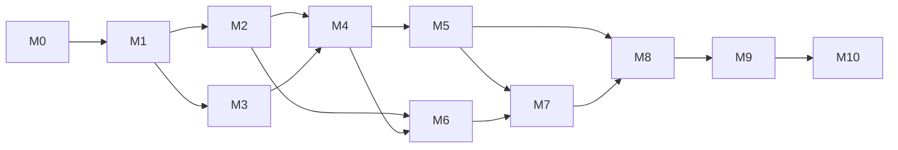

# Project Plan

**Status: Draft.** The project is at the concept and planning stage. Milestone M0 (this repository
scaffold) is in progress; all other milestones are planned. No dates are committed yet.

## 1. Objective

Build and document a Bluetooth-enabled Edge AI demonstrator on the Nordic nRF54LM20 DK that detects
early deviations from the learned healthy condition of a metal ball bearing on a guarded laboratory
test rig, using vibration, acoustic, temperature, and RPM sensing.

## 2. Milestones

| # | Milestone | Deliverables | Depends on | Status |
|---|---|---|---|---|
| M0 | Repository scaffold and planning | Directory structure, placeholder READMEs, planning documents, preliminary BOM, templates | - | In progress |
| M1 | Hardware acquisition | nRF54LM20 DK, sensors (candidates or final), motor and driver, shaft, coupling, supports, bearings, load device, disk and masses, LED, e-stop, PSU, guard material, base plate | M0 | Planned |
| M2 | Test rig build and safety review | Assembled rig, guard, e-stop tested, speed limit set, risk assessment and pre-run checklist signed off | M1 | Planned |
| M3 | Firmware bring-up | SDK pinned, board target verified, sensor drivers reading data, RPM capture, logging, capture build streaming raw data | M1 | Planned |
| M4 | Capture tooling and first healthy recordings | `tools/data_capture` working, metadata validated, first healthy-baseline runs at several speeds | M2, M3 | Planned |
| M5 | Signal analysis and feature design | Findings document; sample rates, windows, bands fixed; feature specification v1 | M4 | Planned |
| M6 | Controlled fault campaigns | Recordings for imbalance, misalignment, loose mounting, increased load, pre-worn bearing at several severities and speeds | M2, M4 | Planned |
| M7 | Model training and evaluation | Stage 1 statistical model; optional Stage 2 model; evaluation report; model card completed | M5, M6 | Planned |
| M8 | On-device pipeline | DSP + Edge AI on the DK, health score, LED indication, baseline learning, persistence | M5, M7 | Planned |
| M9 | BLE service and dashboard | Bearing Health Service with allocated UUIDs; dashboard with live, trend, alert, and configuration views | M8 | Planned |
| M10 | Validation, documentation, publication | End-to-end validation on the rig, limitations documented, Hackster story and attachments, video | M9 | Planned |

## 3. Work packages

| WP | Title | Main directory | Summary |
|---|---|---|---|
| WP1 | Mechanical rig | `mechanical/` | Design, build, and verify the rig and guard; fault-injection methods; sensor mounts |
| WP2 | Electrical hardware | `hardware/` | Sensor selection, wiring, power, e-stop, optional carrier board |
| WP3 | Firmware platform | `firmware/app`, `boards`, `drivers` | SDK setup, drivers, acquisition, capture build, self-test, state machine |
| WP4 | Signal processing | `firmware/dsp`, `tools/feature_extraction` | Feature specification and equivalent C/Python implementations |
| WP5 | Data | `datasets/`, `tools/data_capture`, `tools/signal_analysis` | Capture, metadata, campaigns, analysis |
| WP6 | Edge AI | `models/`, `tools/model_training`, `firmware/edge_ai` | Baseline learning, models, evaluation, export, on-device inference, scoring |
| WP7 | Bluetooth and UI | `firmware/bluetooth`, `tools/ble_dashboard` | Service, security, dashboard |
| WP8 | Documentation and outreach | `docs/`, `hackster/`, `media/` | Planning docs, model card, story, logs, media |

## 4. Decision points

| Decision | Needed by | Input |
|---|---|---|
| Bearing size / shaft diameter / support type | M1 | Availability, cost, ease of bearing exchange |
| Accelerometer selection | M1 | Bandwidth, noise, FIFO, Zephyr support |
| Acoustic sensor type | M5 | Comparison on the rig during M4/M5 |
| Temperature sensing type | M1 | Simplicity vs. accuracy |
| SDK release pin | M3 | nRF54LM20 DK support, stability |
| Capture transport | M3 | Required bandwidth at chosen sample rates |
| Inference runtime | M7 | Model type, memory footprint, toolchain |
| Dashboard platform | M9 | Available skills, target audience |

## 5. Risks and mitigations

| Risk | Impact | Likelihood | Mitigation |
|---|---|---|---|
| nRF54LM20 DK or SDK support not available in time | Delays M3 | Medium | Prototype drivers and DSP on another Nordic DK with the same SDK; keep board-specific code in overlays |
| Induced faults are too subtle or too crude | Weak or trivial results | Medium | Multiple severity levels; signal analysis before model work; honest reporting |
| Rig resonances dominate the vibration signal | Features reflect the rig, not the bearing | Medium | Rigid base plate; characterise rig response; adapt bands |
| Sensor mounting variability | Poor repeatability | Medium | Documented mount procedure; position vocabulary; re-baseline after remount |
| Memory or CPU budget exceeded on device | Reduced feature set or model | Medium | Stage 1 statistical model as fallback; profile early |
| Safety incident with rotating parts | Injury, project stop | Low (with mitigations) | Guard, e-stop, speed limit, risk assessment, checklist, two-person rule for fault tests |
| Data leakage in evaluation | Misleading results | Medium | Run-level splits enforced by tooling |
| Scope creep (fault classification, RUL) | Nothing finished | High | Explicit first objective: anomaly vs. baseline only |

## 6. Verification approach per milestone

- M2: Safety checklist executed; e-stop test documented; guard inspection.
- M3: Each driver verified against a known stimulus (tap test, known RPM, known temperature); capture
  stream integrity check.
- M4/M6: Metadata completeness; integrity reports; at least N independent runs per condition (N TODO).
- M7: Evaluation protocol followed; results reported per condition, severity, RPM.
- M8: On-device features match offline features within tolerance; health score behaviour on replayed data.
- M9: Service verified with a generic BLE explorer and the dashboard; security tested.
- M10: End-to-end demonstration documented with recorded `recording_id`s and limitations.

## 7. Reporting

Progress will be recorded in project logs under [`../hackster/`](../hackster/README.md) and in
[`../CHANGELOG.md`](../CHANGELOG.md). Milestone status in the root README is updated at each milestone.

## TODO

- [ ] Assign target dates once hardware availability is known.
- [ ] Define N (minimum independent runs per condition) in the data-collection plan.
- [ ] Review risks after M3.
