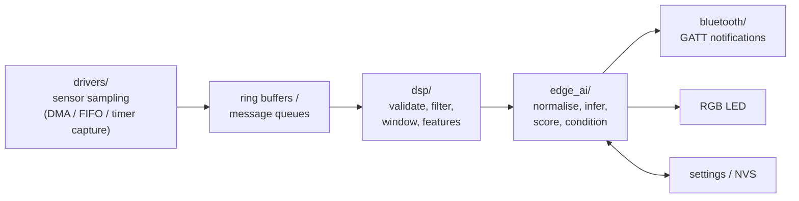

# Firmware

**Status: Planned** - no firmware source code exists yet. This directory documents the planned
nRF Connect SDK / Zephyr application for the Nordic nRF54LM20 DK.

## Purpose

The firmware will run on the nRF54LM20 DK and is responsible for:

1. Acquiring data from the accelerometer, acoustic sensor, temperature sensors, and RPM sensor.
2. Validating, filtering, and windowing the signals.
3. Extracting time- and frequency-domain features and normalising them against RPM and temperature.
4. Running Edge AI anomaly inference against the learned healthy baseline.
5. Computing the Bearing Health Score, condition level, and maintenance recommendation.
6. Exposing results and controls over a Bluetooth LE GATT service and showing the condition on an RGB LED.
7. Persisting baseline statistics, thresholds, and configuration in non-volatile memory.

## Planned toolchain and target

| Item | Plan |
|---|---|
| SDK | nRF Connect SDK (Zephyr RTOS based). The SDK release must include nRF54LM20 DK board support; the exact version will be pinned in `west.yml` once verified. |
| Board target | `nrf54lm20dk/nrf54lm20a/cpuapp` (to be confirmed against the pinned SDK release) |
| Language | C (Zephyr coding style); C++ only if required by the inference runtime |
| Build | `west build -b nrf54lm20dk/nrf54lm20a/cpuapp firmware/app` from an nRF Connect SDK workspace |
| Flash / debug | `west flash`, on-board debugger, RTT or UART logging |
| Testing | Zephyr Ztest with Twister for host-side unit tests of DSP and feature code |

See [`west.yml.example`](west.yml.example) for the planned workspace manifest.

## Planned module layout

```text
firmware/
├── app/          Application: main, state machine, threads, Kconfig, prj.conf, CMakeLists.txt
├── boards/       Devicetree overlays and Kconfig fragments for the nRF54LM20 DK and sensor wiring
├── drivers/      Sensor integration: accelerometer, microphone/piezo, temperature, RPM sensor
├── bluetooth/    Bearing Health GATT service, advertising, security, device information
├── dsp/          Filtering, windowing, FFT, time- and frequency-domain feature extraction
├── edge_ai/      Inference runtime integration, baseline learning, scoring, condition mapping
└── tests/        Ztest unit tests and hardware-in-the-loop test notes
```

Each subdirectory contains a README describing the planned implementation in detail.

## Planned runtime data flow



Planned threads (preliminary):

| Thread | Priority | Responsibility |
|---|---|---|
| Acquisition | High | Service sensor FIFOs/DMA buffers, timestamp samples, push to ring buffers |
| Processing | Medium | Windowing, features, inference, scoring at a fixed evaluation period |
| Bluetooth | Medium | Zephyr Bluetooth host callbacks, notification scheduling |
| Housekeeping | Low | Temperature sampling, RPM averaging, LED update, logging, watchdog feed |

## Planned application states

```text
INIT -> SELF_TEST -> (BASELINE_LEARNING | MONITORING) -> DIAGNOSTIC_CAPTURE -> MONITORING
                                     \-> FAULT (sensor failure, storage error)
```

- **SELF_TEST**: verify sensor presence, sampling rates, and RPM signal.
- **BASELINE_LEARNING**: collect healthy-condition feature statistics over a configurable duration
  and speed range; triggered over BLE.
- **MONITORING**: normal operation; periodic health evaluation and notifications.
- **DIAGNOSTIC_CAPTURE**: temporarily stream a short feature history for engineering analysis.
- **FAULT**: device-level problem indicated on the LED and in the Device Status characteristic.

## Resource budget (to be measured)

| Resource | Planned budget | Notes |
|---|---|---|
| RAM | Sample buffers for vibration (3 axes) and acoustic windows, FFT scratch, model arena | Sizes depend on window length and sample rate; TODO after feature design |
| Non-volatile memory | Application, Bluetooth host, inference runtime, model, settings partition | TODO |
| CPU | Feature extraction and inference well below 100 % duty at the evaluation period | TODO: profile on hardware |
| Power | Not a primary constraint for the bench demonstrator; measured for information using the DK's current-measurement pins | TODO |

## Current status

- No source code, build files, or configuration exist yet.
- The nRF54LM20 DK has not been acquired.
- Toolchain version and board target have not been verified on real hardware.

## TODO

- [ ] Pin the nRF Connect SDK release with nRF54LM20 DK support and record it in `west.yml`.
- [ ] Verify the board target name and available peripherals on the pinned release.
- [ ] Decide on the inference runtime (see [`edge_ai/README.md`](edge_ai/README.md)).
- [ ] Define sample rates, window lengths, and the evaluation period (see [`../docs/edge_ai_plan.md`](../docs/edge_ai_plan.md)).
- [ ] Create the application skeleton (`app/`) once hardware is available for bring-up.
- [ ] Add a continuous-integration build once the application compiles.
