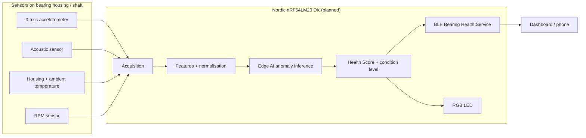

# BearingGuard AI: Early Bearing Fault Detection

*Hackster.io project story - publication-ready draft. Project status: **concept and planning stage**.*

> **Status note for readers:** BearingGuard AI is currently a concept with a detailed plan. The hardware
> has not yet been assembled, no measurements have been recorded, the firmware is not yet functional, and
> no AI model has been trained. Everything described below is the proposed design and the planned
> implementation. Project logs will document real progress as it happens.

## Introduction

Bearings are the quiet workhorses of every rotating machine - and one of the most common reasons those
machines stop unexpectedly. BearingGuard AI is a planned Bluetooth-enabled, Edge AI predictive-maintenance
demonstrator built around the Nordic nRF54LM20 DK. It will listen to a metal ball bearing through four
senses - three-axis vibration, sound, housing temperature, and shaft speed - learn what "healthy" looks
like, and warn over Bluetooth Low Energy as soon as the bearing starts to drift away from that baseline.

## The problem

Bearing damage rarely happens suddenly. Lubricant degrades, surfaces fatigue, a shaft drifts out of
alignment, a mounting bolt loosens, a rotor becomes unbalanced - and vibration, noise, and heat change
subtly long before anything breaks. In practice these signals are missed because:

- most small and medium machines are not monitored at all,
- periodic manual inspections only catch what happens to be visible on the day,
- conventional condition-monitoring systems are wired, costly, and need experts to interpret, and
- simple vibration alarms trip on every speed or load change until someone switches them off.

The result is unplanned downtime, collateral damage to shafts and motors, scrapped production,
discarded healthy parts replaced "just in case", and avoidable safety risks.

## The proposed solution

BearingGuard AI is designed as a compact wireless node mounted at the bearing. The plan is that it will:

1. **Sense** vibration, acoustic signal, housing and ambient temperature, and RPM.
2. **Learn** the healthy baseline of *this* bearing on *this* machine during a supervised learning phase.
3. **Detect** deviations locally with an Edge AI anomaly model running on the nRF54LM20 DK - raw signals
   never need to leave the device.
4. **Normalise** against speed and ambient temperature so that normal operating changes do not trigger alarms.
5. **Explain** the result as a Bearing Health Score (0-100) and a four-level condition indicator:
   green, yellow, orange, red.
6. **Report** health, trends, and maintenance recommendations over BLE to a phone or dashboard, and
   show the condition on an RGB LED.

The first realistic goal is dependable **anomaly detection against a healthy baseline** on a controlled
test rig - not fault classification, and not remaining-useful-life prediction.

## System architecture

The project is organised in five layers:

| Layer | Content |
|---|---|
| Mechanical test rig | Guarded motor-shaft-bearing assembly with replaceable bearings, adjustable load, and imbalance disk |
| Sensing hardware | Accelerometer, MEMS microphone or piezo contact sensor, temperature sensors, RPM sensor, LED, power, emergency stop |
| Firmware (nRF Connect SDK / Zephyr) | Drivers, DSP and feature extraction, Edge AI inference, health scoring, BLE service, storage |
| Data and model pipeline | Capture tooling, signal analysis, feature extraction, training, evaluation, export |
| User interface | BLE dashboard for configuration, live health, trends, and alerts |

## Block diagram

*(Exported image to be uploaded from `media/diagrams/`; Mermaid source below for the repository.)*

## Preliminary bill of materials

All items are **planned**; no part numbers have been fixed or purchased. The full list is in
`hardware/bom/preliminary_bom.csv`.

| Category | Items |
|---|---|
| Processing and connectivity | Nordic nRF54LM20 DK |
| Sensing | Three-axis digital accelerometer; MEMS microphone or piezoelectric contact sensor; digital temperature sensors or NTC thermistors (housing and ambient); Hall-effect or optical RPM sensor with magnet or marker |
| Drive train | Low-voltage DC or BLDC motor; motor driver / speed controller; shaft; flexible coupling; two bearing supports; replaceable metal ball bearings |
| Fault injection | Adjustable load or brake; imbalance disk with captive test masses |
| Indication and safety | RGB status LED; emergency stop switch; transparent protective guard |
| Infrastructure | Low-voltage power supply; base plate; sensor mounting brackets; cables and connectors |

## How the nRF54LM20 DK will be used

The nRF54LM20 DK is planned as the single processing and communication platform:

- **Acquisition**: SPI/I2C for the accelerometer and temperature sensors, PDM for a MEMS microphone or
  the SAADC for a piezo sensor and thermistors, timer capture for the RPM pulses.
- **Processing**: the Arm Cortex-M33 runs filtering, FFT-based feature extraction, and normalisation.
- **Edge AI**: on-device anomaly inference with a model that fits within the available RAM and
  non-volatile memory.
- **Bluetooth LE**: a custom Bearing Health GATT service for reporting and configuration.
- **Storage**: learned baseline statistics and settings in on-chip non-volatile memory.
- **Development**: on-board debugging, logging, and current measurement.

Firmware will be developed with the nRF Connect SDK (Zephyr RTOS). The DK has not yet been acquired by
the project; its specifications will be verified against the official documentation before design freeze.

## How Edge AI will be used

Planned flow: sensor acquisition -> signal validation -> filtering -> windowing -> time-domain features
(RMS, peak-to-peak, crest factor, kurtosis, impulse count) -> frequency-domain features (spectral-band
energies) -> RPM and temperature normalisation -> multisensor fusion -> anomaly inference -> Bearing
Health Score -> maintenance recommendation -> BLE notification and LED.

The model strategy is deliberately staged: first a transparent statistical detector that only needs the
learned baseline, then - if required - a small autoencoder or one-class network trained offline on
healthy data and deployed with integer quantisation. No model has been trained yet; a model card in the
repository will document data lineage and honest evaluation results when they exist.

## How Bluetooth will be used

A custom **Bearing Health Service** is planned with characteristics for Bearing Health Score, Condition
Level, Vibration RMS, Vibration Crest Factor, Acoustic Energy, Housing Temperature, RPM, Anomaly
Score, Maintenance Recommendation, Device Status, Baseline Learning Control, and Diagnostic Capture
Control. Clients subscribe to periodic notifications and receive immediate alerts on level changes;
authenticated writes start baseline learning or a bounded diagnostic capture. BLE never controls the
machine. UUIDs have not yet been allocated.

## Experimental test-rig plan

A bench-top rig will drive a short shaft through a flexible coupling, supported by two replaceable
metal ball bearings, with an imbalance disk and an adjustable load. Sensors are mounted on the
instrumented bearing support. The rig sits on a rigid base plate, has an emergency stop that cuts motor
power independently of the electronics, runs at a documented limited speed, and is fully enclosed by a
transparent guard. **Rotating parts will never be operated without the guard.**

Planned controlled conditions: healthy baseline, mechanical imbalance, controlled misalignment, loose
bearing-housing mounting, increased mechanical load, and pre-worn bearings - each at several speeds and
severity levels, in multiple independent runs.

## Data collection plan

Every recording is a complete measurement run with metadata (bearing ID, RPM, load, sensor positions,
ambient and housing temperature, condition, severity, run ID). Training, validation, and test sets are
split **by complete run**, never by random sample, to avoid data leakage. Raw data stays outside the
repository; raw audio is not retained unless required and legally appropriate; any synthetic data is
labelled as such.

## Milestones

| # | Milestone | Status |
|---|---|---|
| M0 | Repository scaffold and planning | In progress |
| M1 | Hardware acquisition | Planned |
| M2 | Test rig build and safety review | Planned |
| M3 | Firmware bring-up | Planned |
| M4 | Capture tooling and healthy-baseline recordings | Planned |
| M5 | Signal analysis and feature design | Planned |
| M6 | Controlled fault campaigns | Planned |
| M7 | Model training and evaluation | Planned |
| M8 | On-device pipeline and LED indication | Planned |
| M9 | BLE service and dashboard | Planned |
| M10 | Validation, documentation, publication | Planned |

## Sustainability impact

Predictive maintenance replaces bearings when they actually begin to degrade rather than on a fixed
schedule, prevents secondary damage to shafts, housings, and motors, reduces scrap from unplanned
stoppages, and keeps drive trains efficient (worn bearings waste energy as friction). The demonstrator
itself is low-power, wireless, keeps data on the device, and uses a reusable rig. These are expected
benefits; the project does not yet quantify them.

## Limitations

- Concept stage - no results exist yet.
- Anomaly detection relative to a baseline only; no fault classification or remaining-useful-life prediction.
- One bearing type, one rig, laboratory conditions; transfer to other machines is unproven.
- Induced faults may not fully represent field degradation.
- Mounting, rig resonances, and sensor quality strongly influence results.
- Advisory demonstrator only - not certified protection or emergency shutdown equipment.

## Planned final attachments

- **Code**: link to the GitHub repository (firmware, tools, models documentation).
- **Schematics and circuit diagrams**: exported sensor-interface schematic and electrical block diagram.
- **CAD, enclosures, and custom parts**: STEP/STL of brackets, imbalance disk, and guard, plus drawings.
- **Media**: exported diagrams, rig photos, demonstration video (with the guard fitted).

Details: `hackster/attachments_description.md`.

---

*License: Apache-2.0. Disclaimer: BearingGuard AI is an experimental predictive-maintenance demonstrator
and not certified industrial protection or emergency shutdown equipment.*
