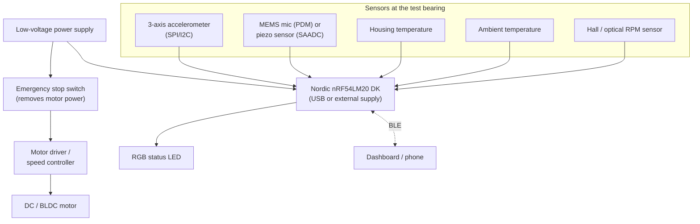

# Hardware

**Status: Planned** - no hardware has been purchased, assembled, or tested.

## Purpose

This directory documents the electrical and electronic hardware of BearingGuard AI: the Nordic
nRF54LM20 DK, the sensors, their interconnection, power, indication, and safety-related electrical
items such as the emergency stop. It also holds the preliminary bill of materials.

## Directory overview

| Directory | Content | Status |
|---|---|---|
| [`block_diagrams/`](block_diagrams/README.md) | System and electrical block diagrams (Mermaid sources and exported images) | Placeholder |
| [`schematics/`](schematics/README.md) | Schematics for any sensor carrier board or analog front end (KiCad) | Placeholder |
| [`pcb/`](pcb/README.md) | PCB layout files and fabrication outputs, if a custom board is made | Placeholder |
| [`wiring/`](wiring/README.md) | Wiring tables, connector pinouts, cable routing, grounding and shielding notes | Placeholder |
| [`bom/`](bom/README.md) | Preliminary bill of materials ([`preliminary_bom.csv`](bom/preliminary_bom.csv)) | Preliminary |
| [`datasheets/`](datasheets/README.md) | Index of official datasheet links (no copies of proprietary documents) | Placeholder |

## Planned hardware architecture

Key planning decisions:

- **Two independent electrical domains.** The motor power path (supply, emergency stop, driver, motor)
  is separate from the sensing and processing path (DK, sensors, LED). The DK never controls the motor.
- **Development-kit-first.** The first iteration uses the nRF54LM20 DK with sensor breakout boards
  wired through its headers. A custom sensor carrier board is a later option.
- **Short, shielded sensor cables.** Vibration and acoustic signals are sensitive to cable-borne noise;
  routing and grounding are documented in `wiring/`.
- **Mounting matters more than electronics.** Accelerometer coupling to the housing dominates the
  usable bandwidth; see [`../mechanical/sensor_mounts/README.md`](../mechanical/sensor_mounts/README.md).

## Current status

- No components have been selected beyond the category level.
- The nRF54LM20 DK has not been acquired.

## TODO

- [ ] Select sensors and confirm interface voltages and levels against the DK I/O voltage.
- [ ] Decide whether a sensor carrier board is needed or whether breakouts suffice.
- [ ] Complete the wiring tables and the electrical block diagram.
- [ ] Review the emergency-stop wiring with the safety plan in [`../docs/safety.md`](../docs/safety.md).
